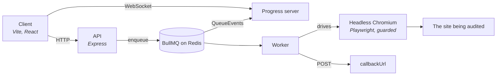
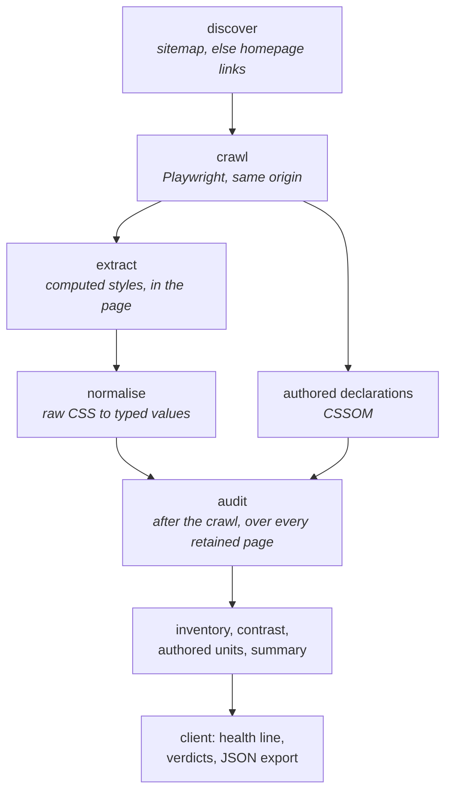
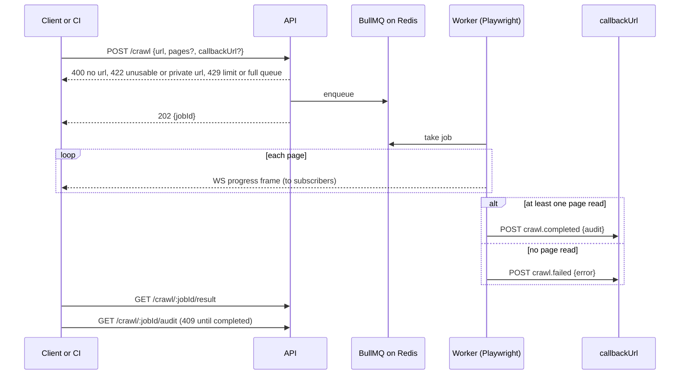

# Drift: architecture

How Drift is built and why: the processes, the data a crawl produces, the boundaries a request
crosses, the mechanisms behind the audit, and how it is tested. The visual design and the token
layer are in [DESIGN.md](./DESIGN.md).

## Contents

- [Overview](#overview)
- [Data model](#data-model)
- [Boundaries and security](#boundaries-and-security)
- [Discovery and crawl](#discovery-and-crawl)
- [Extraction and audit](#extraction-and-audit)
- [Testing and CI](#testing-and-ci)
- [Platform and stack](#platform-and-stack)
- [Known trade-offs](#known-trade-offs)

---

## Overview

Drift crawls a website and reports the design values it ships. Every colour, typeface, size,
radius, shadow, border and spacing value in use is deduplicated, grouped and counted, with the
element tags it appears on. Colours also list the pages they appear on. Everything is computed: Drift calls no model API and gives
the same audit for the same pages.

One Node process runs the Express API, the WebSocket progress server and a BullMQ worker with
concurrency 2. Redis holds the queue. The client is a separate Vite build.

Each page is read twice. `getComputedStyle` gives the resolved values, and the CSSOM gives the
declarations as written. The audit runs once, after the crawl, over every page, so memory grows
with elements times pages and the [page cap](#page-cap) bounds it.

The queue runs each job once (`attempts: 1`) and fails a stalled job instead of retrying it
(`maxStalledCount: 0`). Completed jobs are kept for an hour or the last 100, failed jobs for a day.

---

## Data model

A crawl produces a `CrawlResult`: the root URL, a timestamp, and per page the URL, title, element
count, normalised elements, breakpoints and authored declarations. `collectAudit` turns it into a
`SiteAudit`. `SiteAudit` is in [`openapi.yaml`](./openapi.yaml), rendered as the
[API reference](https://drift.hipuku.dev/reference/). The contract describes each page of a
`CrawlResult` by its URL, title and element count only; the elements, breakpoints and authored
declarations are typed in `src/crawler/types.ts`.

| `SiteAudit` field                                                 | Contents                                                                                                                                                              |
| ----------------------------------------------------------------- | --------------------------------------------------------------------------------------------------------------------------------------------------------------------- |
| `summary`                                                         | Counts: pages, colours, near-duplicates, families, type sizes and weights, sizes off the scale, spacings off the grid, radii, shadows, contrast pairs and AA failures |
| `colourFamilies`                                                  | Swatches by hue family: hex, count, roles, elements, pages, OKLCH lightness, nearest and related colours                                                              |
| `typography`                                                      | Families, the size each element role uses, sizes with weights and tags, weights, line heights, letter spacings                                                        |
| `spacing`, `radius`, `shadow`, `borders`                          | Distinct values with counts, and tags or properties                                                                                                                   |
| `opacity`, `zIndex`, `blur`, `gradients`, `motion`, `breakpoints` | Present when the site uses them                                                                                                                                       |
| `authored`                                                        | The dominant unit for spacing, font size, radius and border width, the site's own custom properties, and whether font size is mostly `px`                             |
| `contrast`                                                        | Distinct text and background pairs with ratio, AA, AAA and large-text AA, count, tags and pages, lowest ratio first                                                   |

Colour clustering and WCAG ratios come from `haus-colour-utils`: CIEDE2000 for distance, with near
duplicates below ΔE 2, and OKLCH hue for families. The health line, the verdicts and the export are
computed in the client from `SiteAudit` and are not on the API.

---

## Boundaries and security

The contract is `openapi.yaml`. `src/server/contract.test.ts` validates the app's responses
against it, `npm run lint:api` checks it is valid OpenAPI, and drift-tests generates its types from
it. Completion comes from `/result`, not the socket, so a dropped socket does not stall the client.

### Access

Every crawl drives a headless browser through up to ten pages, each allowed 30 seconds to load,
so an open endpoint spends the host's machine. The rules are in `src/server/access.ts`.

- **Where it listens.** `127.0.0.1` unless `HOST` is set. The server warns at startup when it
  listens beyond loopback with no token.
- **Token.** With `DRIFT_API_TOKEN` set, every route and the progress WebSocket need
  `Authorization: Bearer <token>`, compared in constant time, and refuse with `401` and
  `WWW-Authenticate: Bearer`. The WebSocket reads it from the header only, so it never lands in an
  access log as part of a URL. The token is for API callers such as CI: the client sends none.
- **Limits.** `POST /crawl` and `POST /discover` share a per-caller limit,
  `DRIFT_RATE_LIMIT_PER_MINUTE`: 20 when exposed, none on loopback. A crawl is refused while
  `DRIFT_MAX_QUEUED` (20) crawls wait or run, counted and enqueued one request at a time so two
  cannot take the last slot. Both answer `429` with `Retry-After`.
- **Transport.** The backend serves plain HTTP. An exposed server belongs behind a reverse proxy
  that terminates TLS.

### Private addresses

Every URL Drift fetches comes from a caller, so each is an SSRF vector. `src/net/publicUrl.ts`
holds one rule: a host passes when every address it resolves to is public. Refused: `0.0.0.0/8`,
`10/8`, `100.64/10`, `127/8`, `169.254/16`, `172.16/12`, `192.168/16`, `224/4` and above, `::`,
`::1`, `fc00::/7`, `fe80::/10`, `ff00::/8`, and IPv4-mapped forms of the IPv4 ranges.

- **The site to crawl** is checked by `POST /crawl` and `POST /discover`, which answer `422`.
- **Every browser request** is checked again in `src/crawler/guard.ts`, because a public page can
  redirect, embed or load from anywhere. Requests are fetched with redirects off and each hop is
  checked, at most five. Service workers are blocked, because their requests bypass routing.
- **Sitemap fetches** follow redirects by hand with the same check on each hop.
- **Callbacks** are checked at enqueue and again when the result is delivered, and are never
  redirected.

`DRIFT_CRAWL_ALLOWED_HOSTS` and `DRIFT_WEBHOOK_ALLOWED_HOSTS` exempt named hosts, which is how
drift-tests crawls and receives on `127.0.0.1`. A site to crawl must also have a dot in its host,
so `localhost` is refused before the crawl allowlist is read; a callback has no such check, so an
allowlisted `localhost` callback works.

### Outbound requests

The crawl (pages and their assets), discovery (the reachable-URL check, `robots.txt` and sitemaps)
and webhook deliveries. Nothing else: no analytics, and the API reference page has Scalar's
telemetry off.

### Webhooks

A `callbackUrl` receives `crawl.completed` with the audit, or `crawl.failed` with an `error`. Every
delivery has `x-drift-event`, and `x-drift-signature: sha256=<hex>`, the HMAC-SHA256 of the raw
body, when `DRIFT_WEBHOOK_SECRET` is set. Delivery makes up to three attempts, 10 seconds each,
500ms and then 1s apart. A network error, a timeout or a `5xx` is retried; a `3xx` or `4xx` ends
delivery. A failed delivery is logged and does not fail the crawl.

---

## Discovery and crawl

`POST /discover` resolves the input to a reachable URL, trying the host with and without `www.`. It
reads `Sitemap:` lines from `robots.txt`, or tries `/sitemap.xml`, `/sitemap_index.xml` and
`/wp-sitemap.xml`, and follows sitemap indexes up to 15 documents and 500 URLs. Author, category,
tag, feed, `wp-` and dated-permalink paths are dropped. With no sitemap it loads the homepage and
lists same-origin links, without action endpoints such as `vote` or `login`. The list is capped at
1,000 pages. `robots.txt` is read for `Sitemap:` lines only; its rules are not obeyed (#19).

| Cost             | Cause                                                    | Current limit                          |
| ---------------- | -------------------------------------------------------- | -------------------------------------- |
| Time             | Each page is a headless navigation and a DOM walk        | Worker concurrency 2, page cap         |
| Memory           | Every element of every page is kept until the audit runs | Page cap, and 12,000 elements per page |
| Load on the site | Requests to a site the operator does not own             | Same-origin pages only, page cap       |

A caller either names the pages or gets a breadth-first walk of same-origin links from the root. A
URL is same origin when its parsed origin equals the root's. Only pages are limited to the root's
origin: a page can still load stylesheets, fonts and other assets from public third-party hosts,
which the browser guard checks like any other request. Each page gets 30 seconds to reach
`domcontentloaded`; a page that fails is logged and skipped.

### Page cap

**Decision.** At most 10 pages per crawl (`MAX_CRAWL_PAGES`, enforced by the server and mirrored in
the page picker), at most 12,000 elements per page (`maxElements` in `haus-style-probe`), and no
retries.

**Reason.** A crawl of a content site ran the backend out of memory, and BullMQ re-ran the job on
restart, which crashed it again. The limits bound a crawl at about 120,000 retained elements. Most
values come from shared stylesheets, so a few pages find most of a site's values.

**Alternatives.** Incremental aggregation, which would fold each page into tallies and drop its
elements, lifting the cap. Not built.

---

## Extraction and audit

### Contrast measurement

**Decision.** Contrast is measured on composited colours. `haus-style-probe` records each element's
nearest ancestor background with any alpha; `contrast.ts` composites it over white, then the text
colour over the result. A finding keeps the authored `foreground` and `background` and adds
`resolvedForeground` and `resolvedBackground` when compositing changed them.

**Reason.** `#111111` at 50% alpha on white measures 18.88 with the alpha ignored and passes AAA.
It renders as `#888888`, measures 3.54 and fails AA. Muted secondary text is commonly written this
way.

**Alternatives.** Compositing during extraction and storing only the resolved colours. Rejected:
someone fixing the stylesheet edits `rgba(17,17,17,0.5)`, not `#888888`.

A translucent ancestor is composited over white, not over what sits behind it, so a 50% panel over
a dark hero is measured as if the page were white.

### Authored and computed values

**Decision.** Each page is read through `getComputedStyle` and through the CSSOM of every
same-origin stylesheet. Computed values are the record of what rendered; the CSSOM adds authored
units and custom property names.

**Reason.** Computed styles return pixels: they lose the authored unit, split one `rem` value into
sub-pixel variants such as `1.96195px` and `1.96209px`, and ignore declared custom properties. Only
`rem` can be recovered from a pixel value.

Cross-origin sheets throw on `cssRules` and are skipped. Font size reads `font-size` only, since
line height is usually unitless and letter spacing usually `em`. The CSSOM is collected by
property, not by selector, so it adds no interactive states.

### Reference scales

**Decision.** One function, `detectClosestRatio`, picks the automatic type scale for the server's
`typeOffScale`, the type tab and the export. It ranks ratios by how many sizes miss them, then by
mean relative error.

**Reason.** Ranking by error alone chose a ratio that sat close to most sizes but missed more of
them: for 16, 22, 23 and 25px, a minor third with two sizes off over an augmented fourth with one.
Until 2026-09-14 the server and the tab ranked differently and could disagree. A test asserts the
server and client copies agree.

### Export shape

**Decision.** The export starts with `health`, `findings[]` (typed, with severity and evidence),
`verdicts` and `rules` (the ΔE threshold, ratio, grid and WCAG thresholds), then `summary` and the
inventory.

**Reason.** It is for machines: a CI assertion, a diff of two runs. A consumer given only counts
would have to recompute the verdicts. The client builds it; no endpoint serves it (#3), because the
public deployment is a replay.

### Empty crawls

**Decision.** A crawl that reads no page fails with a reason, and `/audit` stays `409`.

**Reason.** It used to end `completed` with an all-zeros audit, which an API client read as a
successful audit of an unreachable site.

---

## Testing and CI

| Suite      | Where                                                | What                                                                                                                 |
| ---------- | ---------------------------------------------------- | -------------------------------------------------------------------------------------------------------------------- |
| Service    | `src/**/*.test.ts`                                   | 234 tests in 19 files: the analysis, the API against `openapi.yaml`, the address and access rules, the queue adapter |
| Client     | `client/src/**/*.test.ts(x)`                         | 235 tests in 13 files: screens with axe, the token tests, the audit model                                            |
| End to end | `client/e2e`                                         | Against the demo build: the audit flow by keyboard, every tab, focus visibility, the API reference                   |
| Acceptance | [drift-tests](https://github.com/hipuku/drift-tests) | BDD scenarios over HTTP against a real server, Redis and a fixture site                                              |

drift-tests waits for the server by sending `POST /discover` with no `url` and expecting `400`,
which involves no Redis, Playwright or network. Changing that status breaks its readiness probe.

CI runs six jobs on every pull request, each required on `main`: `Lint` (ESLint, Stylelint, the
prose check and `lint:api`), `Format`, `Typecheck`, `Test`, `Build` and `End to end`. CodeQL scans
the code. CI does not crawl a real site; drift-tests crawls its own fixture.

`package.json`, `openapi.yaml` and the release tag carry the same version. drift-tests records
`git describe --tags` of the checkout it tested, and tests `main` unless started with a tag.

---

## Platform and stack

The full stack is listed in the [README](./README.md#stack).

### Server runtime

**Decision.** Express in one long-lived process that holds the API, the WebSocket server and the
worker.

**Reason.** A WebSocket server, Playwright browsers and BullMQ workers all need a process that
stays up.

**Alternatives.** Next.js API routes, which are request-scoped and usually serverless, with no
process to hold a socket or a worker pool. A custom Next server would keep the constraints without
using the rendering.

### Client build

**Decision.** A Vite and React single-page app.

**Reason.** The client is one flow: configure, progress, audit. There are no public pages to
render on the server or index.

### Job queue

**Decision.** BullMQ on Redis.

**Reason.** A crawl runs for minutes and fails often, so it runs off the request thread with
concurrency control and progress events, which map onto the WebSocket frames.

**Alternatives.** An in-memory queue, which loses jobs on restart. pg-boss, which would add
Postgres beside Redis.

### Progress channel

**Decision.** WebSockets. A client sends `subscribe` with a job id and receives `progress` frames,
then `completed` or `failed`. The server forwards BullMQ `QueueEvents`, so the worker can run in
another process.

**Reason.** Planned crawl controls (pause, cancel, change scope) need client-to-server messages.

**Alternatives.** Server-Sent Events, which carry one-way progress equally well. If the controls are
dropped, SSE would be slightly simpler, and not worth the change.

### Colour science

**Decision.** CIEDE2000 distance, WCAG contrast, OKLCH conversion and the hue-family boundaries
come from `haus-colour-utils`.

<!-- ASK: why the colour maths lives in a shared package rather than in drift -->

The hue boundaries were first worked out here, from the OKLCH hues of each family's namesake;
vault's HSL boundaries had misnamed 17 of 27 reference colours. They moved into the package in
0.2.1, and in 0.3.0 were refitted to 4,275 colours people named.

---

## Known trade-offs

- **DNS rebinding** (#85). Every check resolves a host, and the request then resolves it again:
  Node for fetched pages, assets and webhook deliveries, the browser for WebSockets and the
  redirect hops it follows once the guard has walked the chain. Neither the crawl nor the webhook
  pins the checked address, so a name whose answer changes in between can reach a private
  address. Closing it needs every connection made to the checked address, through an egress proxy.
- **One process.** The rate limiter's counters live in memory, and behind a reverse proxy every
  request shares one caller address. Several processes would need a shared store.
- **The demo capture can go stale.** The public build replays a capture from 2026-08-30. An analysis
  change alters what a new capture would show; `npm run capture` recaptures and prints the figures
  the docs quote. Nothing fails when it is out of date.
- **No Dockerfile.** The planned image is multi-stage and installs Chromium only, about 300MB, with
  a compose file for Redis.
