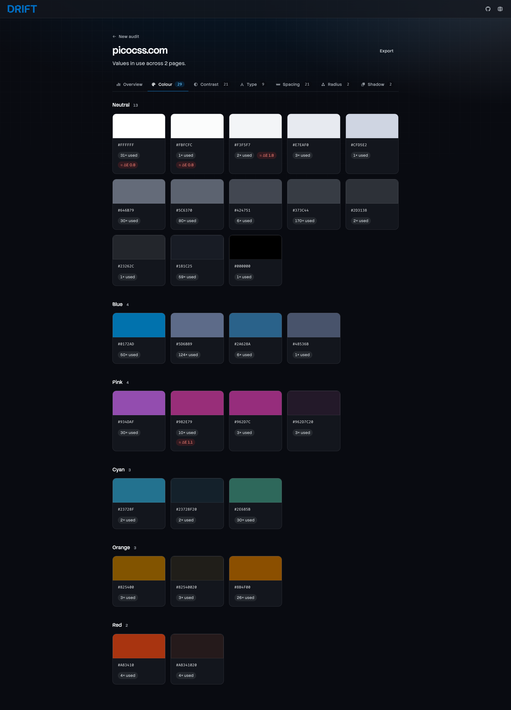
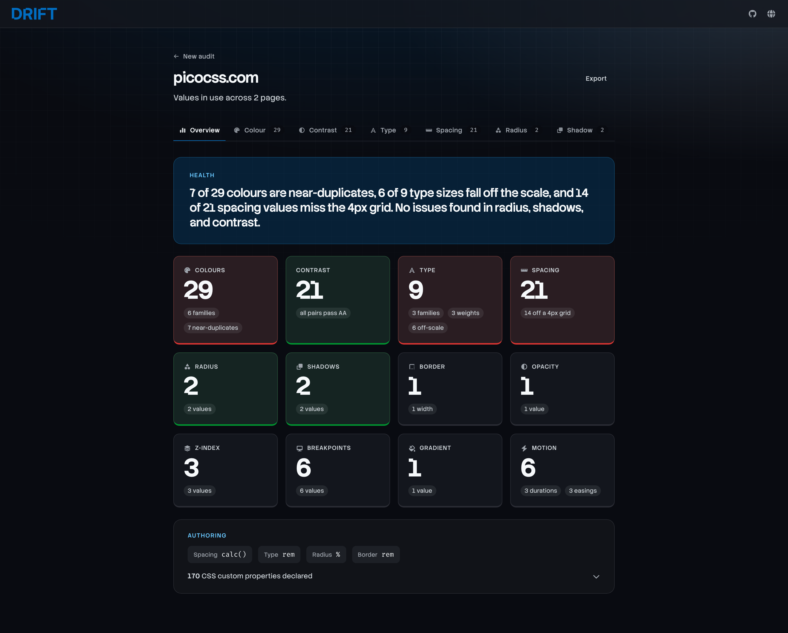
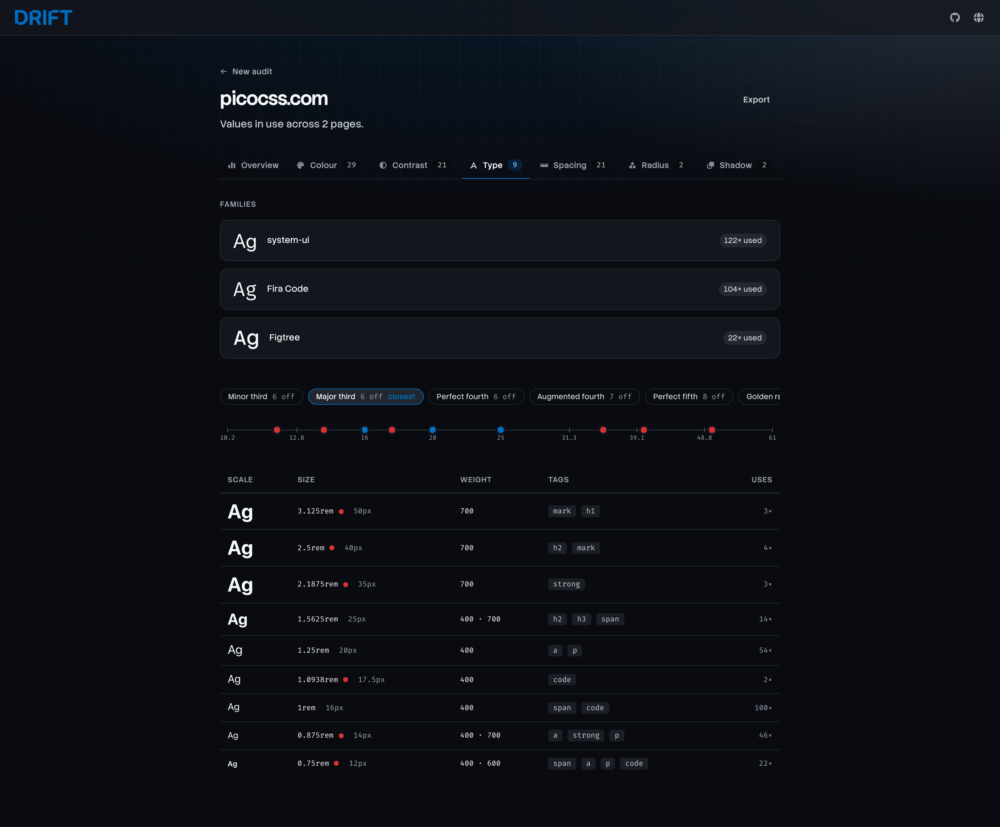

# Drift: design

Why Drift looks and behaves the way it does, and the token layer underneath. It starts from one
stance: the audit states measurements against a named reference and does not recommend changes.
How it is built is in [ARCHITECTURE.md](./ARCHITECTURE.md). The design file is
[drift on Figma](https://www.figma.com/design/cG4D315cHRDKDwMQovDu7R/drift); more of the work is
on the [hipuku Figma profile](https://www.figma.com/@hipuku).

<!-- Link the drift file's pages from Tokens, Components and Layout once they exist. -->

## Contents

- [Visual language](#visual-language)
- [Typography](#typography)
- [Layout and interaction](#layout-and-interaction)
- [Design system](#design-system)
- [Known gaps](#known-gaps)

---

## Visual language

### Theme

**Decision.** Dark only: one token set in `:root`, no toggle.

**Reason.** Drift was always dark by default, and the light theme was a second surface to design,
test and keep honest, for no product gain (a97c8f7).

### Accent

**Decision.** One blue accent, generated as an OKLCH tonal ramp from two values,
`--drift-color-accent-h` (239) and `--drift-color-accent-c` (0.19). Lightness is fixed per step, so white text
on the 600 anchor clears AA whatever the hue.

**Reason.** The theme playground retunes the whole brand by changing a hue and a chroma, the same
OKLCH ramp idea Drift reports on. The hue itself is a visual choice.

**Alternatives.** The primary button's raised look was five fixed `oklch()` values at hue 200, so
retuning the accent moved every surface but left the button's shadow blue-green. It became a role
that follows the ramp (f6fda5c).

### Surfaces and elevation

**Decision.** Cool blue-slate neutrals at very low chroma. The page sits darker than the cards, and
elevation comes from hairline borders rather than shadows.

**Reason.** In the dark, shadows barely read, so a visible hairline does the elevation work, and a
darker page lets the cards sit above it.

---

## Typography

### Typefaces

**Decision.** Stack Sans Text for the interface, Stack Sans Notch for headings and display, and
Fira Code for every measured value. All three are bundled with the client.

**Reason.** Visual choices, made by comparing typefaces in Figma.

### Type roles

**Decision.** A role carries only the properties its element sets. The eleven typeset roles set
size, weight, leading and tracking; emphasis sets weight only; a table cell sets family and size
and takes leading from the row.

**Reason.** A role that sets more than its element needs forces overrides, and every override is a
primitive read.

---

## Layout and interaction

### Measurements, not proposals

**Decision.** The audit reports each value against a stated reference (a modular ratio, a spacing
grid, CIEDE2000 ΔE, WCAG 2.1) and stops there. It does not propose a cleaned-up system.

**Reason.** A proposal is a recommendation, and "arithmetically tidier" is weak grounds for one.

**Alternatives.** A proposals layer, built and cut: a palette merged by ΔE, a role-first type scale,
a detected spacing grid, and named radius, shadow and z-index ladders, each with a preview and an
export. Kept from it, because they measure rather than recommend: selectable references, CIEDE2000
near-duplicates and the JSON export. The code, and the design notes for a second version, are in git history.

### Verdicts

**Decision.** The Overview is a health line, then one card per category tinted by its verdict:
good, watch or review. A card opens its category's tab.

### Selectable references

**Decision.** The type tab lists every named ratio with how many sizes miss it, and the spacing tab
offers a 4px or 8px grid. Choosing one redraws that tab's ruler and table. The Overview always uses
the automatic fit.

**Reason.** A size is off-scale only relative to a scale, so the reference has to be visible and
changeable. Keeping the Overview on the automatic fit means trying the golden ratio does not change
the diagnosis. How the fit is chosen is in
[ARCHITECTURE.md § Reference scales](./ARCHITECTURE.md#reference-scales).

### Tabs

**Decision.** The audit tabs are a full tablist: ids, `aria-controls`, a roving `tabindex`, a
`tabpanel` that takes focus when it holds nothing focusable, and Arrow Left and Right, Home and End.

**Reason.** The tabs carried `role="tab"` and nothing else, so a screen reader announced "tab,
selected" with no way to reach what was selected, and a keyboard user tabbed through eight buttons
instead of arrowing within one stop (#27).

### The demo's URL field

**Decision.** In the public build the URL field arrives filled with picocss.com and cannot be
edited, but still takes focus and is still announced.

**Reason.** The demo can only replay the site it captured.

---

## Design system

### Tokens

**Decision.** Drift defines every custom property it reads, in seven cascade layers in three groups,
lowest first:

- **`foundation.*`** (`tokens/foundation.css`): primitives, motion and semantic roles. 176
  declarations, all `--drift-*`.
- **`base.*`** (`tokens/primitives.css`, `tokens/semantics.css`): 5 primitives and 15 roles Drift
  adds, such as two elevation levels, a panel radius and two insets below the 4px grid.
- **`drift.*`** (`styles/drift.css`): the theme, mapping surface, ink, border and primary onto the
  blue-slate and accent ramps.

Every name follows `--drift-{category}-{name}`: `color` (`--drift-color-neutral-500`,
`--drift-color-surface-default`), `type` (`--drift-type-size-14`, `--drift-type-body-size`),
`space`, `radius`, `motion`, `elevation`, `size`, `opacity`, `border-width` and `z`, plus `focus`
and `gradient` for the focus ring and the page background. Primitives and roles share the
categories, so a role sits beside the scale it draws from. Primitives are named by their value
(`--drift-type-leading-140`, `--drift-motion-duration-200`) and roles by their job
(`--drift-type-body-leading`, `--drift-motion-duration-ui`), so the two read apart within a group.

`tokens/layers.css` declares the order before any file opens a layer, so import order cannot
change it. Components read roles, not primitives. Spacing roles come in three kinds over one ladder:
`inset` for padding, `gap` between siblings and `stack` for margin in flow.

**Reason.** Drift reports on other products' token layers. Styled with the design system from the
same portfolio, its own UI would be an instance of what it audits, and its look would follow haus
releases: the heading tracking change in `haus#37` reached Drift through a version bump.

**Alternatives.** `haus-tokens`, adopted on 2026-08-30 and removed on 2026-09-09. Names from
three schemes (haus's foundation, unprefixed additions in `base.*`, haus's fruit-named status
ramps) and a forwarding brand layer were consolidated into the one pattern on 2026-11-16. The same
day, adjective names for leading, weight and duration gave way to values (`tight` was 1.15 and
`tighter` 1.2), and ten roles nothing read were dropped: the disabled surface, border and primary,
the overlay and inverse surfaces, inverse ink, the three severity colours and a second disabled
opacity.
`foundation.css` was generated once from `haus-tokens@3.2.0`, renamed to `--drift-*`, and is edited
by hand now; a computed-styles comparison of 2,680 elements found no difference from the rename.
`haus-colour-utils` and `haus-style-probe` stay: they are analysis code, not a design system.

### Components

Five components in `client/src/components`: Badge, Button, Callout, Text and TextField. The four
screens in `client/src/screens` (Configure, Crawling, Audit, Status) compose them. Layers import their own
or a lower one: components import no other layer, `lib`, `demo` and `hooks` import no interface,
and screens never reach up into the flow, the shell or the dev harness. ESLint fails the build
otherwise (`no-restricted-imports` in `eslint.config.js`); tests are exempt. Badge and Input
came from `haus-components` on 2026-08-30 and returned to Drift's own on 2026-09-09: two shared
components used once each did not justify the dependency.

### Accessibility

Every screen's test runs axe. The end-to-end suite drives the audit by keyboard and fails if focus
lands on anything not visible, the defect it was written to catch. The tablist was rebuilt to the
full pattern after an audit found it was tabs in name only (#27, 2026-09-07).

### Enforcement

- **Accessibility in JSX.** `eslint-plugin-jsx-a11y-x`, the recommended set, over every client
  component and screen: a missing `alt`, a click handler on an element that cannot take focus or an
  invalid ARIA role fails the build. The two roving-tabindex containers, the audit tablist and the
  scale radiogroup, are exempt at their sites, because focus sits on their items.
- **Hardcoded values** (#26). Stylelint fails a component style that uses a raw colour, length,
  radius, shadow or font value. The first run found 44; 8 had an exact token, and the rest are
  recorded with a reason, as a grouped list in `stylelint.config.js` or an inline disable.
  `--report-needless-disables` fails a disable that is no longer needed.
- **Token tests** (`tokens/tokens.test.ts`). Every `var(--x)` without a fallback names a defined
  property; CSS modules read no primitive outside the recorded debt; and every `@keyframes` name a
  module uses is defined in that module. An undefined `--duration-default` once left five animations
  with no duration, and a stylesheet split once left two animations without their keyframes.
- **Computed styles** (`e2e/computed-styles.spec.ts`). A before-and-after check for refactors,
  run locally: record a baseline of the audit report's computed styles, make the change, and the
  diff shows what rendering moved. The baseline carries one machine's font metrics, so it is
  skipped in CI, and a missing baseline is recorded and passes.

---

## Known gaps

- **Type-tier debt: 42 reads.** `TYPE_TIER_DEBT` in `tokens.test.ts` records them as a count per
  name, and a count that moves in either direction fails until the record moves too. 33 are
  `font-family` (no type role carries a family, and `<button>` and `<input>` do not inherit one);
  9 are single-property reads on elements that already use a role.
- **`Audit.module.css` is 694 lines** (#2, parked). The colour, overview, type, spacing and scalar
  sections have their own modules now. The first split was reverted, and the second broke two
  animations, which the keyframes test was then written to catch.
- **A class used in a component and missing from its CSS module** is not caught. It typechecks and
  is `undefined` at runtime.
