# Drift: features

The report tabs, in the app's order, with screenshots from the demo build. The demo replays an
audit of picocss.com captured on 2026-08-30. Each figure below names the reference it was
measured against.

## Contents

- [Overview](#overview)
- [Colour](#colour)
- [Contrast](#contrast)
- [Type](#type)
- [Spacing](#spacing)
- [Radius, shadow and border](#radius-shadow-and-border)
- [Opacity, z-index, blur and gradients](#opacity-z-index-blur-and-gradients)
- [Breakpoints and motion](#breakpoints-and-motion)
- [Authored units](#authored-units)
- [Export](#export)
- [API](#api)
- [Not built](#not-built)

---

## Overview

A health line, then one card per category, tinted by its verdict: good, watch or review. The
card counts come from the audit's `summary`. Clicking a card opens that category's tab.

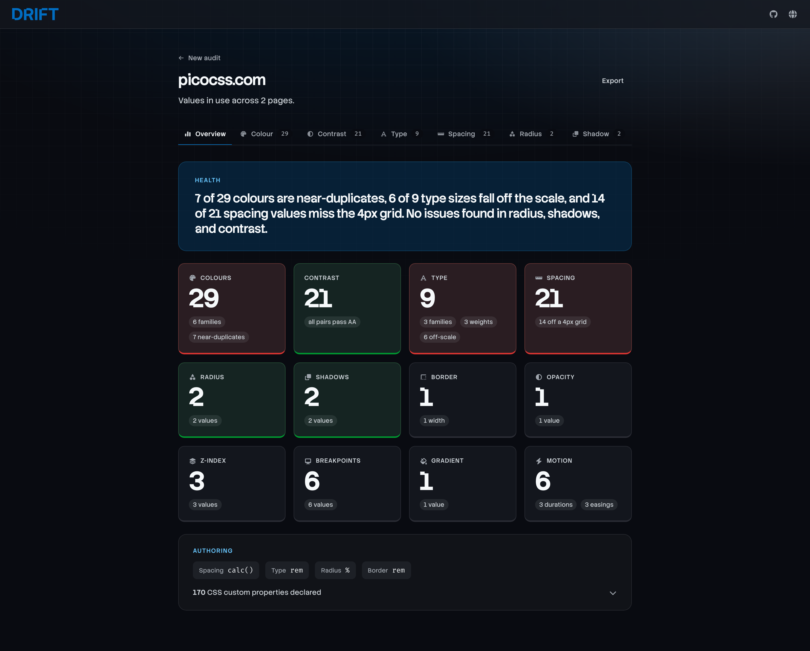

For the demo capture the health line reads: _7 of 29 colours are near-duplicates, 6 of 9 type
sizes fall off the scale, and 14 of 21 spacing values miss the 4px grid. No issues found in
radius, shadows, and contrast._

> [!NOTE]
> **How it works:** [Verdicts](./DESIGN.md#verdicts), [Data model](./ARCHITECTURE.md#data-model)

---

## Colour

Every colour in use, grouped into hue families and ranked by usage. Each swatch shows its roles
(text, background, border) and the pages it appears on.

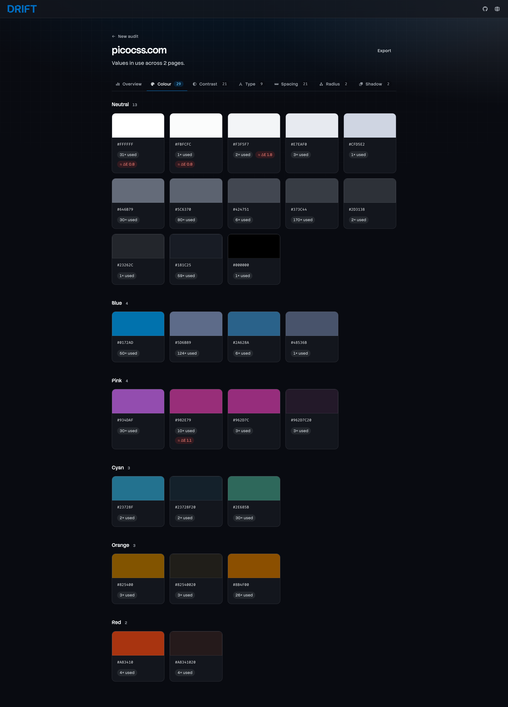

Two colours less than CIEDE2000 ΔE 2 apart are counted as near-duplicates. Selecting a swatch
opens a rail listing its opacity variants (the same hex base at a different alpha) and its
near-duplicates. Choosing one scrolls to its card.

> [!NOTE]
> **How it works:** [Colour science](./ARCHITECTURE.md#colour-science)

---

## Contrast

Every distinct text and background pair, with its WCAG 2.1 ratio and AA and AAA results, lowest
ratio first.

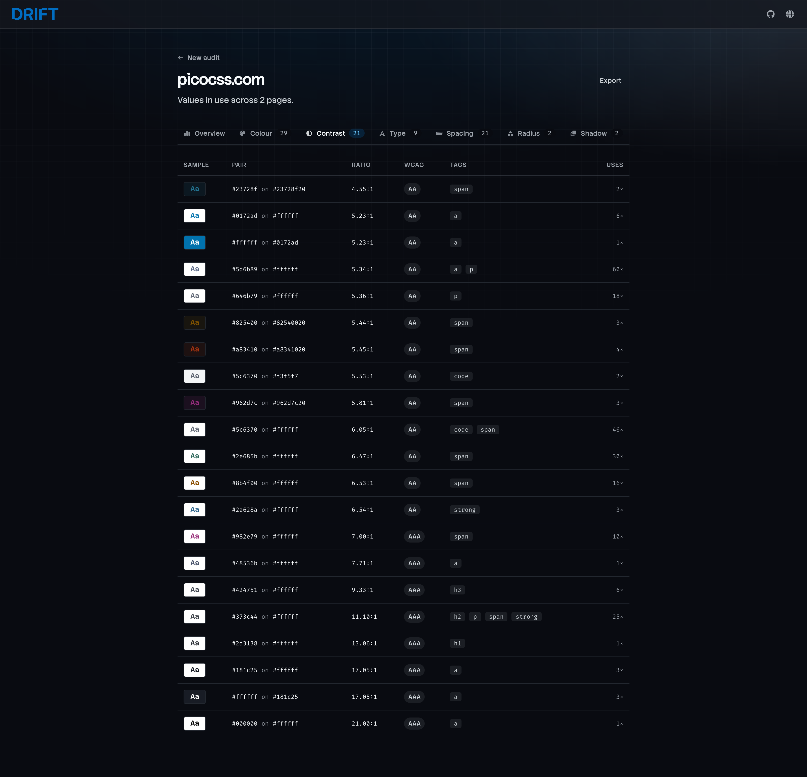

Each pair uses the nearest ancestor background, and alpha is composited before the ratio is
taken, so text is measured as it renders.

> [!NOTE]
> **How it works:** [Contrast measurement](./ARCHITECTURE.md#contrast-measurement)

---

## Type

Font families with usage counts, then the size ladder.

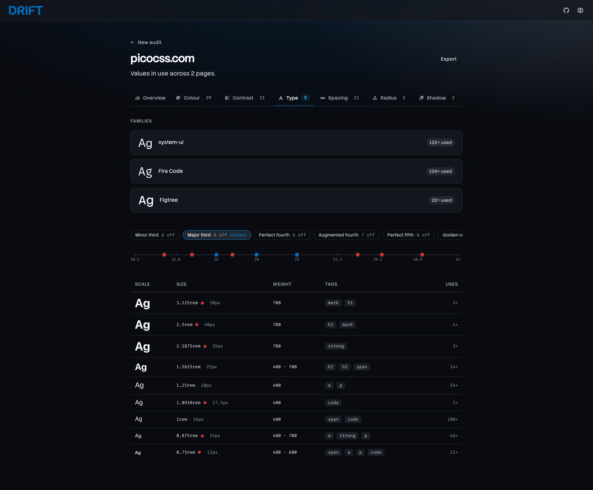

Sizes are plotted on a log axis against the steps of a modular scale, and sizes more than 0.75px
from a step are marked. Each named ratio in the selector shows how many sizes miss it. The
automatic fit is the ratio that the fewest sizes miss, with mean relative error breaking a tie.
The Overview verdict uses the automatic fit whichever ratio is selected on this tab.

Each row shows the authored unit beside the computed pixels.

> [!NOTE]
> **How it works:** [Selectable references](./DESIGN.md#selectable-references), [Reference scales](./ARCHITECTURE.md#reference-scales)

---

## Spacing

Every padding, margin and gap value, with a bar for its size and the element tags and properties
it appears on.

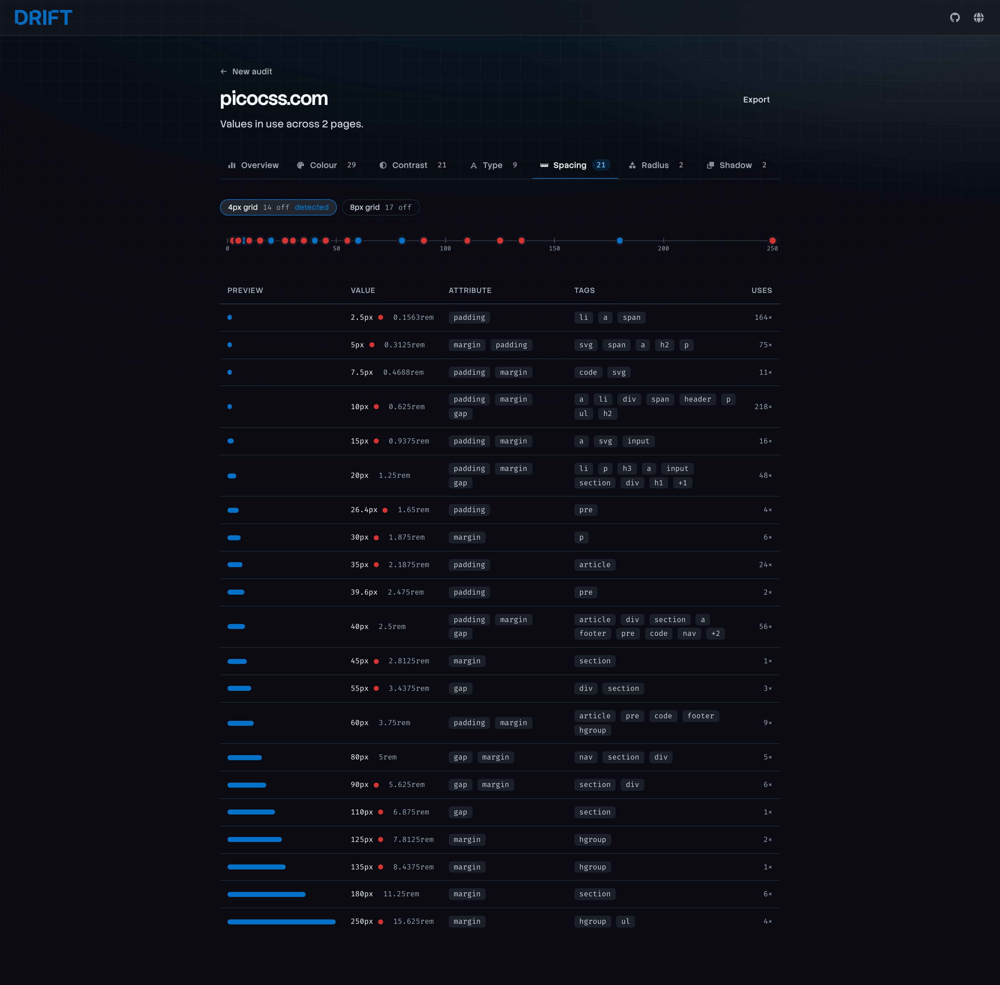

Measured against a 4px or 8px grid, with 0.5px tolerance, selectable like the type ratio. The
tab defaults to 8px when every value sits on it, and to 4px otherwise. The health line always
counts against 4px.

> [!NOTE]
> **How it works:** [Selectable references](./DESIGN.md#selectable-references)

---

## Radius, shadow and border

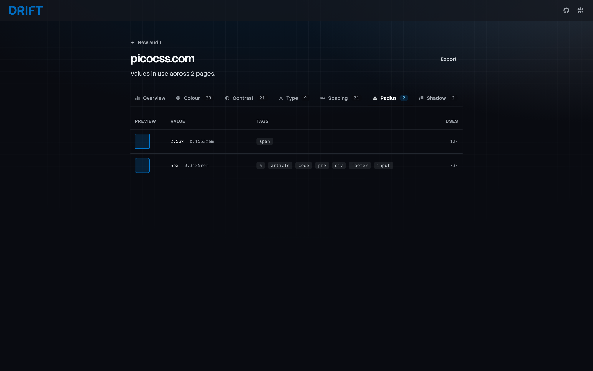
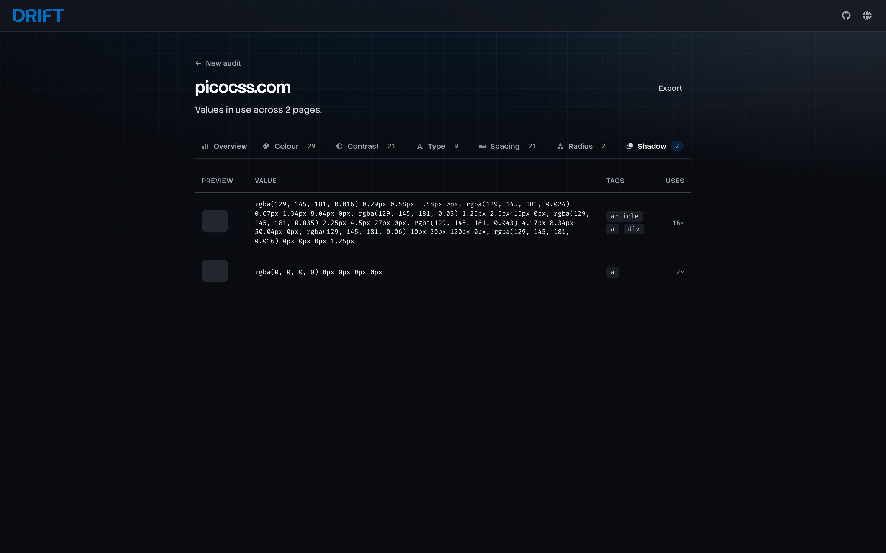

Radii within 1px of each other are counted as near-duplicates, such as 4px beside 4.9px. Border
widths use 0.5px, so 1px beside 1.5px counts. Shadows have no duplicate check; more than six
distinct shadows marks the Shadows card "watch" and adds a clause to the health line.

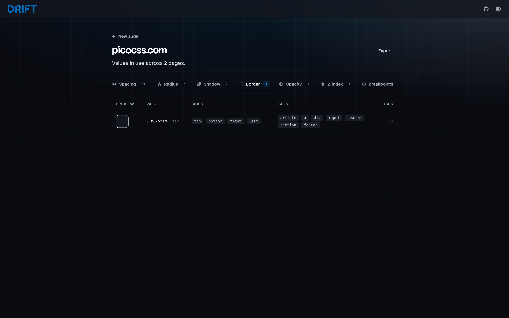

---

## Opacity, z-index, blur and gradients

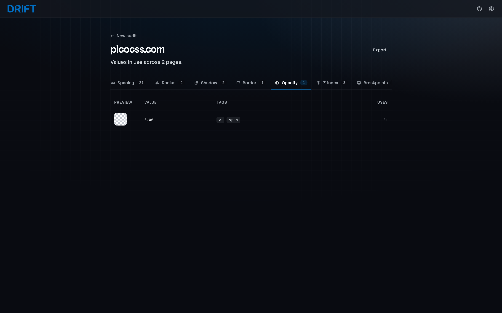
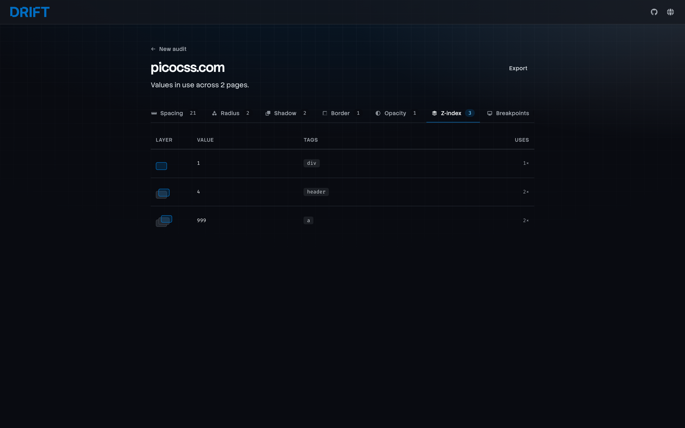

Z-index values are drawn as a stacking ladder. More than eight distinct values, or any value of
9999 or above, adds z-index to the health line.

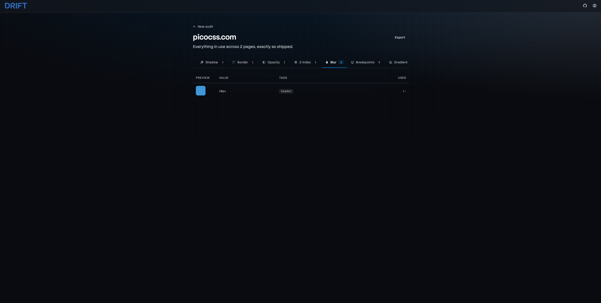
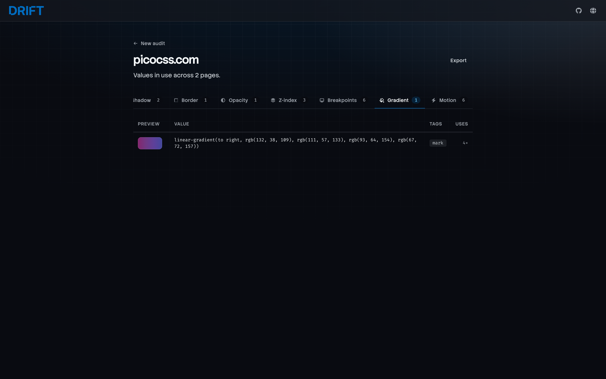

picocss.com sets no `backdrop-filter`, so the demo has no blur tab. `blur.png` was captured from
a different site and cannot be regenerated from the demo capture.

---

## Breakpoints and motion

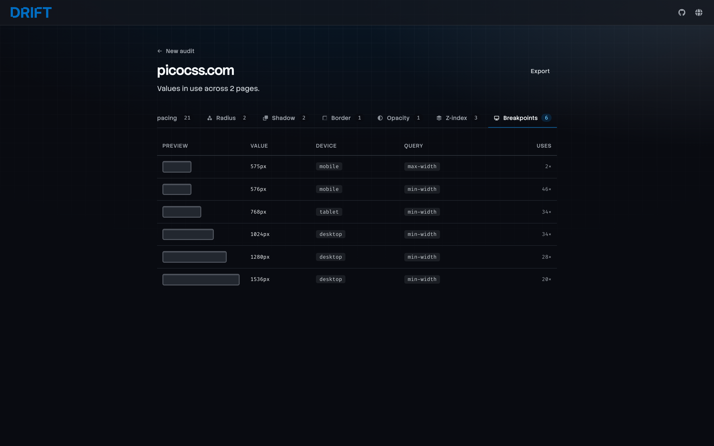

Breakpoints are read from the media queries in same-origin stylesheets, labelled by device class
and counted separately as `min-width` and `max-width`.

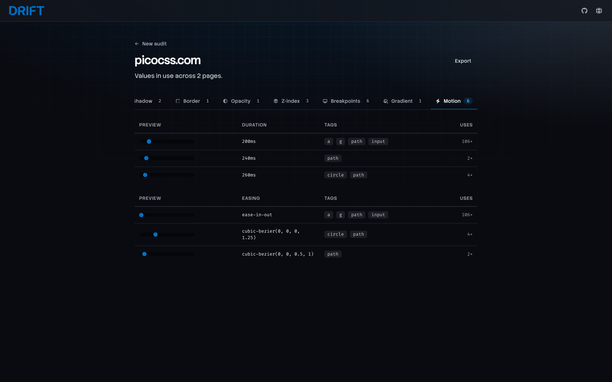

Each duration and easing animates a sample dot at that value.

---

## Authored units

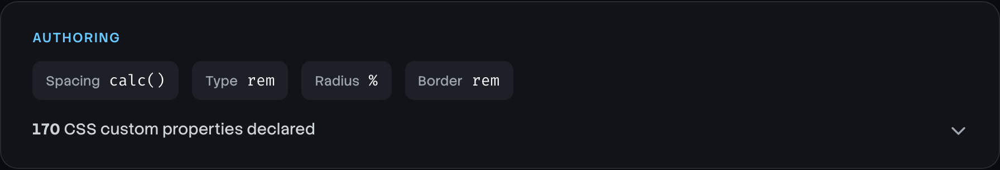

The units the stylesheets use, per category, read from the CSSOM, along with the site's own
custom properties. `1rem` and `16px` compute to the same pixels, so this is the only place the
difference shows.

> [!NOTE]
> **How it works:** [Authored and computed values](./ARCHITECTURE.md#authored-and-computed-values)

---

## Export

The audit as one JSON file: `health`, `findings[]` with severity and evidence, `verdicts`, and a
`rules` block with the ΔE threshold, the detected ratio, the grid base and its tolerance, the
radius tolerance and the WCAG AA thresholds. The summary and the full inventory follow.

Two exports can be diffed, and a CI job can assert on `findings`. The client builds the file;
no endpoint serves it.

> [!NOTE]
> **How it works:** [Export shape](./ARCHITECTURE.md#export-shape)

---

## API

The client uses the same HTTP API a CI job would: list a site's pages, queue a crawl, follow its
progress over a WebSocket, then read the result and the audit. A `callbackUrl` receives the audit
when the crawl ends, so a CI job can fail a build on a threshold without polling. The
[API reference](https://drift.hipuku.dev/reference/) is generated from
[`openapi.yaml`](./openapi.yaml).

> [!NOTE]
> **How it works:** [Boundaries and security](./ARCHITECTURE.md#boundaries-and-security)

---

## Not built

- Crawling at more than one viewport width. Responsive values outside the crawl width are not
  seen.
- Interactive states. `getComputedStyle` sees the resting state.
- Obeying `robots.txt` (#19). It is read for `Sitemap:` lines only.
- Proposals: a cleaned-up palette, scale or grid. See
  [Measurements, not proposals](./DESIGN.md#measurements-not-proposals).
