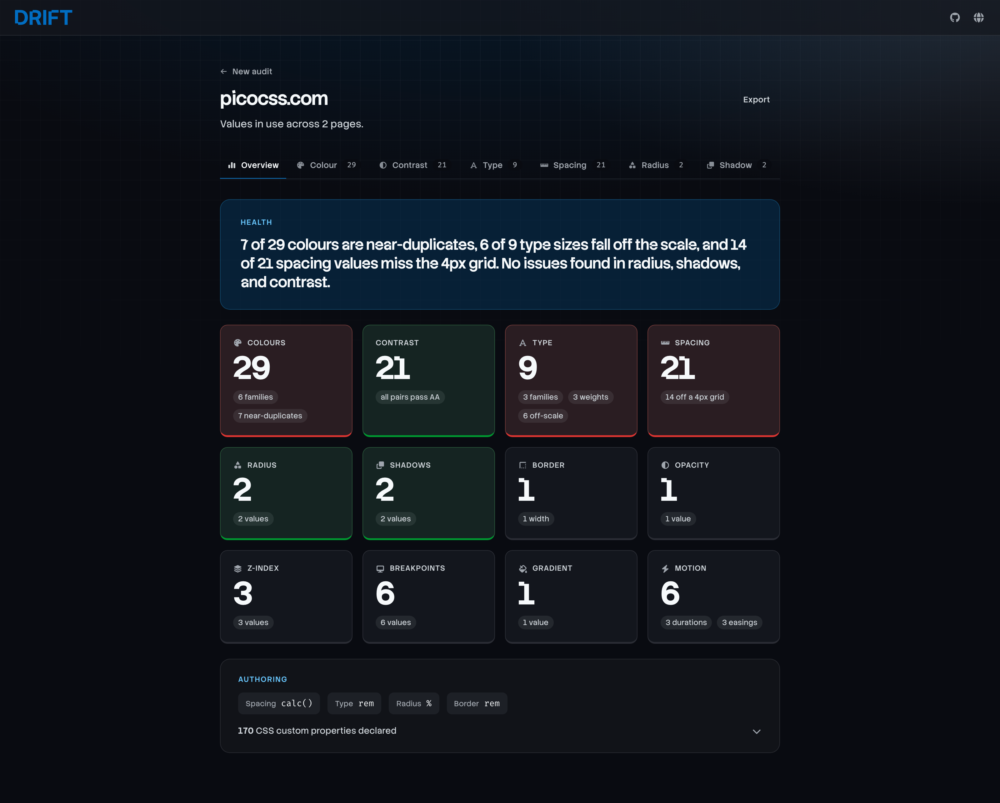

# drift

Drift crawls a website and reports the design system it actually ships: every colour, typeface,
size, radius, shadow, border and spacing value in use, grouped perceptually, ranked by usage and
measured against a stated reference. A Node backend
crawls with Playwright behind a Redis queue, and a React client reads the result. The public demo
replays an audit of picocss.com, so nothing needs installing to see it.



[](https://www.hipuku.dev/work/drift)
[](https://drift.hipuku.dev)
[](https://drift.hipuku.dev/reference/)
[](https://www.figma.com/design/cG4D315cHRDKDwMQovDu7R/drift)

## At a glance

- **Measurements, not proposals.** Every value is reported against a named reference, never
  "fixed". [DESIGN § Measurements, not proposals](./DESIGN.md#measurements-not-proposals)
- **Composited contrast.** Text alpha and the nearest ancestor background are composited, over
  white, before the WCAG ratio is taken. [ARCHITECTURE § Contrast measurement](./ARCHITECTURE.md#contrast-measurement)
- **Authored units.** The CSSOM is read beside computed styles, so `rem` and custom properties
  survive. [ARCHITECTURE § Authored and computed values](./ARCHITECTURE.md#authored-and-computed-values)
- **A guarded crawler.** Every request the browser makes is checked against private addresses.
  [ARCHITECTURE § Private addresses](./ARCHITECTURE.md#private-addresses)
- **Its own token layer, enforced.** Lint and tests fail a raw value or an undefined property.
  [DESIGN § Enforcement](./DESIGN.md#enforcement)
- **Built for CI.** One HTTP API, with webhooks, for the client and a build alike.
  [ARCHITECTURE § Webhooks](./ARCHITECTURE.md#webhooks)

## Documentation

| File                                                 | Covers                                                                        |
| ---------------------------------------------------- | ----------------------------------------------------------------------------- |
| [`FEATURE.md`](./FEATURE.md)                         | Every report tab, with screenshots                                            |
| [`DESIGN.md`](./DESIGN.md)                           | Visual language, interaction and the token layer                              |
| [`ARCHITECTURE.md`](./ARCHITECTURE.md)               | Processes, data, security, the audit's mechanisms and testing                 |
| [`openapi.yaml`](./openapi.yaml)                     | The API contract, as the [API reference](https://drift.hipuku.dev/reference/) |
| [drift-tests](https://github.com/hipuku/drift-tests) | Acceptance tests that drive the API over HTTP                                 |

## Install

Redis must be reachable, at `redis://127.0.0.1:6379` unless `REDIS_URL` says otherwise.
Chromium comes from Playwright.

```bash
npm install
npx playwright install chromium
```

## Develop

Node 22.12 or later (`engines`); `.nvmrc` pins 22. The backend process owns the API, the
WebSocket server and the crawl worker. The client dev server proxies `/api` and `/ws` to it.

```bash
npm run dev:server
```

```bash
npm --prefix client run dev
```

The backend listens on `127.0.0.1:3001` and the client on :5173. Exposing the API to other
machines needs `HOST`, `DRIFT_API_TOKEN` and TLS in front:
[ARCHITECTURE § Access](./ARCHITECTURE.md#access), and `.env.example` for every setting.

## Scripts

| Command              | Does                                                                       |
| -------------------- | -------------------------------------------------------------------------- |
| `npm run dev:server` | Backend: API, WebSocket progress, crawl worker                             |
| `npm run crawl`      | Crawl a URL to JSON, without the queue or the server                       |
| `npm run capture`    | Recapture the bundled demo audit and print the figures the docs quote      |
| `npm run discover`   | Resolve a URL and list its candidate pages                                 |
| `npm test`           | Vitest over the service                                                    |
| `npm run typecheck`  | `tsc --noEmit`                                                             |
| `npm run lint`       | ESLint (typescript-eslint and react-hooks) over the service and the client |
| `npm run lint:css`   | Stylelint, including the hardcoded-value gate                              |
| `npm run lint:prose` | Fails on a new em dash in any tracked file                                 |
| `npm run build`      | `tsc` to `dist/`                                                           |

`client/` has its own `dev`, `build`, `build:demo`, `preview`, `test`, `typecheck`, `e2e` and
`screenshots`.

## The deployed demo

The public build does not run the crawler: it replays an audit captured from a real crawl of
picocss.com, and the configure screen says so. To audit another site, run Drift locally.
`npm run capture` recaptures the demo, and `npm --prefix client run build:demo` builds it.

## Stack

Node · Express · Playwright · BullMQ on Redis · WebSockets · React · TypeScript · Vite ·
CSS Modules · `haus-colour-utils` · `haus-style-probe`
